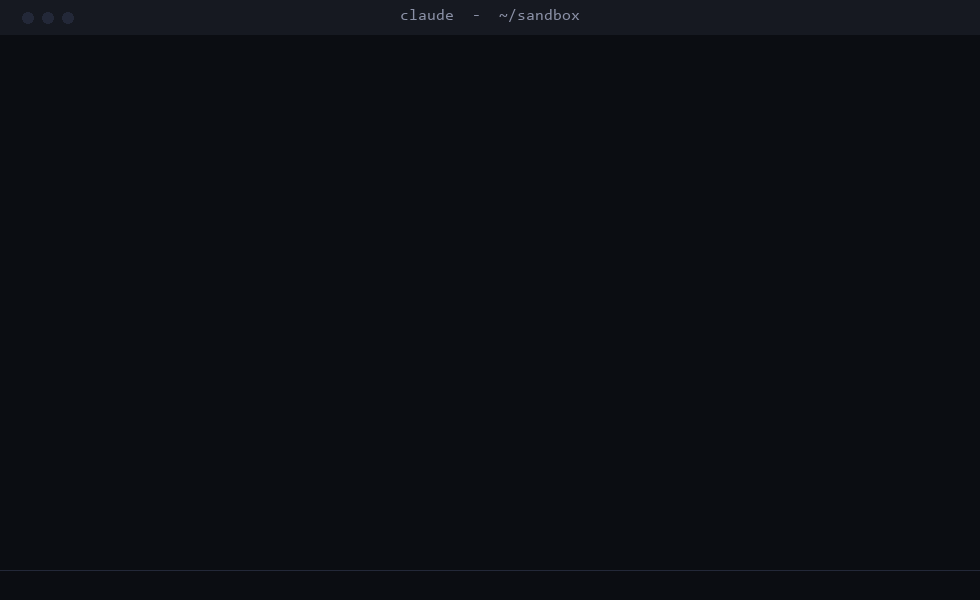
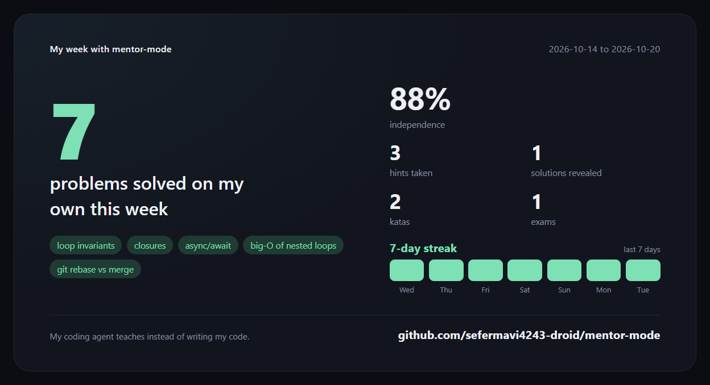

# mentor-mode

**Your coding agent, but it refuses to do your homework.**

`mentor-mode` turns Claude Code into a mentor. It reads your code, runs your tests and asks
the right question, but it **cannot write your code**. A tool guard blocks every edit to
your files while mentor mode is on. You type. You learn. It keeps score.



<sub>Redrawn from real Claude Code sessions with the plugin: prompts shortened, replies trimmed, nothing invented. Rebuild it with <code>python scripts/demo/make_gif.py</code>.</sub>

Status line, always visible: `mentor socratic | hint 0/4 | solved 1 | reveals 0`

## Why

AI agents made it easy to ship code you do not understand. That is fine for a deadline
and terrible for learning. Juniors are told "do not use AI while you learn", which is
like being told not to use a calculator in 2026. `mentor-mode` is the third option:
use the strongest model there is, as a teacher instead of a ghostwriter.

## What it does

| | |
|---|---|
| **Write guard** | `Write` and `Edit` to your files are denied while it is on. Shell commands that write files (`>`, `tee`, `sed -i`, `cp`, `Set-Content`, `python -c` ...) are denied too. The agent may only write its notes in `.mentor/`. |
| **Hint ladder** | Help comes in four rungs, and you choose when to climb: **nudge** (a question), **concept** (the idea, on an unrelated example), **shape** (pseudocode), **fragment** (at most 5 lines for the hardest part). |
| **Four styles** | `guide` (patient, explains), `socratic` (only questions), `reviewer` (you write, it reviews like a strict PR), `strict` ("Show me what you tried."). |
| **Honest scoreboard** | Solved on your own, hints taken, solutions revealed. Per project, kept across sessions. `/mentor reveal` exists, and it counts. |
| **Learning journal** | The agent keeps `.mentor/journal.md`: what you struggled with, what unlocked it, and a recall question for each entry. |
| **Spaced recall** | Next session it opens with a recall question from your journal, before anything else. |
| **Exams** | `/mentor exam src/parser.ts` asks three questions about the code (what it does, an edge case, a changed requirement) and grades each answer. Works great on code an AI wrote for you last week. |
| **Katas from your own repo** | `/mentor kata src/utils` picks a real function from your codebase and turns it into an exercise in `.mentor/kata/`: a README, an empty stub and tests checked against the original. You reimplement it; the original stays hidden until you are done. The fastest way to learn a codebase you did not write. |
| **Weekly card** | `/mentor wrapped` turns your week into a card you can share: problems solved on your own, independence score, streak, the concepts you learned. |
| **Any language** | It answers in the language you write in. |

## Your week, on one card

`/mentor wrapped` writes a self-contained 1200x630 card, sized for LinkedIn and X. Open it in a browser and take a screenshot.



<sub>Example data. Your card is built from your own history and journal.</sub>

### How a kata works

```
> /mentor kata src/utils
Building a kata from your own codebase. You write the solution; the tests tell you when it works.

  Your kata is in .mentor/kata/chunk/. Run it with: node .mentor/kata/chunk/test.js
  When the tests pass, run /mentor done.
```

The agent writes the stub once. After that, `solution.js` is yours: the guard denies the agent any
further edit to it, so it cannot solve the kata for you.

## Install

In Claude Code:

```
/plugin install mentor-mode --marketplace sefermavi4243-droid/mentor-mode
```

Answer `y` to add the marketplace, then pick a scope. From a shell:

```
claude plugin install mentor-mode --marketplace sefermavi4243-droid/mentor-mode
```

### Other agents (Codex, Cursor, Copilot, Gemini CLI)

Copy [`portable/AGENTS.md`](portable/AGENTS.md) into your `AGENTS.md`, `.cursor/rules/` or custom
instructions. You get the same teaching contract, styles, hint ladder, journal and exams, steered with
plain words (`hint`, `reveal`, `done`, `exam`). The write guard and the scoreboard need the plugin.

## Commands

| Command | |
|---|---|
| `/mentor` | Turn on (or show the scoreboard when on) |
| `/mentor guide\|socratic\|reviewer\|strict` | Turn on in that style |
| `/mentor hint` | Climb one rung |
| `/mentor reveal` | Full solution, walked through line by line. Counts as a reveal. |
| `/mentor done` | Mark the problem solved; resets the ladder |
| `/mentor exam [path]` | Three questions, graded |
| `/mentor kata [path]` | Turn a real function of your repo into an exercise |
| `/mentor wrapped` | Write this week's card to `.mentor/wrapped.html` (works with mentor mode off too) |
| `/mentor status` | Scoreboard |
| `/mentor off` | Back to a normal agent |

## For teachers and bootcamps

Commit `portable/AGENTS.md` into an assignment repo and every student's agent becomes a tutor
for that repo. Ask students to hand in `.mentor/journal.md` with their solution: it shows how they
got there, not only where they ended up.

## How it works

`mentor-mode` is a Claude Code hooks module ([`hooks/register.ts`](hooks/register.ts)):

- a `tool.call` guard on `Write`, `Edit`, `NotebookEdit`, `Bash` and `PowerShell`, which also keeps kata solutions for the learner;
- a `prompt.submit` hook that hands the model the teaching contract
  ([`hooks/teaching.ts`](hooks/teaching.ts)) when it changes, and a one-line reminder otherwise;
- the `/mentor` command, with progress and a dated activity history kept in the plugin's store, per project;
- [`hooks/wrapped.ts`](hooks/wrapped.ts), which turns that history and the journal into the weekly card.

`portable/AGENTS.md` is generated from the same `teaching.ts`, so the two never drift:

```
npm run build:portable
```

Tests run against the real engine:

```
claude plugin test .
```

### Limits, honestly

The shell guard is a heuristic. It catches the ways an agent normally writes files, not every way a
determined one could. The real defense is the contract: the model is told plainly that you are learning,
and it cooperates. If you want the answer badly enough, `/mentor off` is right there. That is the point:
it is your call, made on purpose.

## Contributing

Ideas that would make this better: more styles (a "rubber duck" that only listens, an
"interviewer" for practice), real spaced repetition for recall questions, a classroom mode a teacher can
lock on. Issues and pull requests are welcome. Please write them yourself.

## Türkçe

`mentor-mode`, Claude Code'u bir mentora dönüştürür: kodunu okur, testlerini çalıştırır, doğru soruyu
sorar ama **senin yerine kod yazamaz**. İpuçları dört basamakta gelir, ne zaman çıkacağına sen karar
verirsin. Öğrendiklerin `.mentor/journal.md` dosyasına yazılır, bir sonraki oturum bir hatırlatma
sorusuyla başlar. `/mentor kata` kendi projendeki gerçek bir fonksiyonu alıştırmaya çevirir,
`/mentor wrapped` haftanı paylaşılabilir bir karta döker. Hangi dilde yazarsan o dilde cevap verir.

## License

MIT
